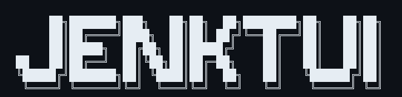
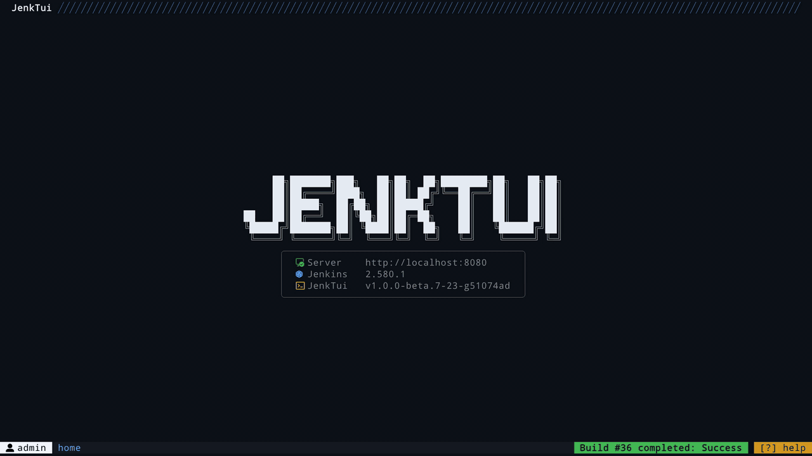

<div align="center">

<br>
<b>JenkTui - TUI for Jenkins</b>
<br><br>
<br>
</div>

<br>

> **Beta Software**: This project is currently in beta. Expect breaking changes in future releases as the configuration and features stabilize.

## Demo

<div align="center">

<br>
</div>

## Features

* Multiple Jenkins servers
* Folders, pipeline jobs, and multibranch pipelines
* Trigger, replay, and abort builds
* Pipeline stages and artifact downloads
* Console log viewer with incremental loading and search, built for large logs
* Global search using Jenkins's built-in search
* My Runs history of builds you trigger
* Optional desktop notifications when your builds end
* Favorites for jobs, multibranch pipelines, and folders
* Built-in themes, plus custom JSON themes
* Configurable keybindings

## Installation

### Jenkins Requirements

JenkTui requires the Jenkins [Pipeline: REST API](https://plugins.jenkins.io/pipeline-rest-api/) plugin (`pipeline-rest-api`). It provides the WFAPI endpoints used to retrieve pipeline runs and stage information.

### Install with Go

```bash
go install github.com/atm1020/jenktui@latest
```

### Build from source

Requires [Go](https://go.dev/dl/) and [Task](https://taskfile.dev/installation/):

```bash
git clone https://github.com/atm1020/jenktui.git
cd jenktui
task build
```

### Nix development environment

With [Nix](https://nixos.org/download/) installed and `nix-command` and `flakes`
enabled, enter the development shell:

```bash
nix develop
task build
task check
```

The flake follows [Crush's development setup](https://github.com/charmbracelet/crush/blob/main/flake.nix)
and pins its inputs in `flake.lock`. It provides Go 1.26, Task, gopls,
golangci-lint, gofumpt, Delve, and tmux on Linux and macOS
(x86_64 and aarch64). The shell matches the Taskfile's Go build environment;
race-test tasks enable CGO and use the shell's C compiler.

For automatic shell activation, install [direnv](https://direnv.net/) with
[nix-direnv](https://github.com/nix-community/nix-direnv) and run `direnv allow`.
Docker-based Jenkins development still requires a separately installed Docker
daemon and Compose.

## Configuration

JenkTui uses two separate JSON configuration files. Application settings are created on first run; server credentials are saved only after setup succeeds:

- **`server.json`** — Jenkins connection credentials
- **`config.json`** — Application settings (polling, theme, keybindings)

### Config File Locations

| Platform | Path |
|----------|------|
| Linux | `~/.config/JenkTui/` |
| macOS | `~/Library/Application Support/JenkTui/` |
| Windows | `%APPDATA%\JenkTui\` |

### Server Configuration (`server.json`)

With no servers configured, JenkTui opens an interactive setup form instead of exiting.
Enter a name, Jenkins URL, username, and API token. Use `tab` / `shift+tab` to
move between fields, `ctrl+a` for the optional CA certificate, and `enter` to
test and save. The read-only connection test checks authentication, TLS, and
Jenkins read access with a five-second timeout. Errors remain in the form for
retry; `esc` or `ctrl+c` cancels. Canceling first-run setup exits without saving.

Press `ctrl+s` to select a server, `a` to add one, or `e` to edit the selected
server. Editing shows a fixed `**..` token placeholder, never the stored token.
Leave it untouched to retain the credential; type a replacement to change it.
Successful setup connects immediately and remembers the server. Server files
are private (`0600`); tokens and server response bodies are excluded from setup
errors and logs. Malformed JSON remains an explicit error and is not replaced.

JenkTui supports multiple servers and still accepts manually managed configuration:

```json
{
  "servers": [
    {
      "id": "jenkins1",
      "name": "Jenkins1",
      "jenkins_url": "https://jenkins1.example.com",
      "username": "your-username",
      "api_token": "your-api-token",
      "ca_cert_path": "/path/to/optional-company-ca.pem"
    },
    {
      "id": "jenkins2",
      "name": "jenkins2",
      "jenkins_url": "https://jenkins2.example.com",
      "username": "your-username",
      "api_token": "your-api-token"
    }
  ]
}
```

`ca_cert_path` is optional and accepts a PEM-encoded CA certificate or bundle.
Setup validates the certificate before saving. For existing configurations,
JenkTui reads it before connecting and provides it to the Jenkins requester.
An unreadable configured certificate remains a startup error. When omitted,
normal system certificate verification is used; insecure TLS bypass is not offered.

### Application Configuration (`config.json`)

Only the fields you want to override need to be specified — missing fields are merged with defaults.


#### Desktop notifications

Desktop build-completion notifications are disabled by default. Enable them with the `notification` block:

```json
{
  "notification": {
    "desktop_enabled": true,
    "sound_enabled": false
  }
}
```

When `sound_enabled` is `true`, failed builds use a critical alert while other results use a normal-urgency notification with a system beep. When sound is disabled, all notifications remain normal urgency and silent. `desktop_enabled` is the master switch, so no notification or sound is sent when it is `false`. Configuration changes take effect after restarting JenkTui.

#### Themes

Set `theme` in `config.json` to a built-in name (`GitHub Dark`, `Dracula`, `Nord`, `Tokyo Night`, and others), or pick one at runtime with the theme selector. Custom palettes are JSON files in `<config-dir>/themes/`:

```json
{
  "bg": "#0D1117",
  "accent": "#58A6FF",
  "bright_fg": "#E6EDF3",
  "fg": "#7D8590",
  "green": "#3FB950",
  "yellow": "#D29922",
  "red": "#F85149"
}
```

The filename without `.json` is the theme name. A file whose name matches a built-in theme (display name or id, case-insensitive) overrides that palette. Colors must be `#RRGGBB`.

<details>
<summary><strong>Key map override example</strong></summary>

```json
{
  "poll_interval": 3,
  "theme": "GitHub Dark",
  "notification": {
    "desktop_enabled": false,
    "sound_enabled": false
  },
  "key_map": {
    "global": {
      "global_search": ["ctrl+p"],
      "back": ["b"],
      "forward": ["]"],
      "quit": ["ctrl+c"],
      "help_toggle": ["?"],
      "help": ["ctrl+g"],
      "theme_selector": ["ctrl+t"],
      "server_selector": ["ctrl+s"],
      "my_runs": ["m"],
      "favorites": ["f"]
    },
    "dialogs": {
      "global_search": {
        "help": ["ctrl+g"],
        "quit": ["ctrl+c"],
        "toggle_focus": ["tab"],
        "focus_up": ["ctrl+k"],
        "focus_down": ["ctrl+j"],
        "search": ["enter"],
        "clear_input": ["ctrl+r"],
        "down": ["j"],
        "up": ["k"],
        "next_page": ["l"],
        "prev_page": ["h"],
        "select": ["enter"]
      },
      "theme_selector": {
        "select": ["enter"],
        "up": ["up", "k"],
        "down": ["down", "j"],
        "close": ["ctrl+c"]
      },
      "node_selector": {
        "select": ["enter"],
        "up": ["up", "k"],
        "down": ["down", "j"],
        "close": ["ctrl+c"]
      },
      "server_selector": {
        "select": ["enter"],
        "up": ["up", "k"],
        "down": ["down", "j"],
        "add": ["a"],
        "edit": ["e"],
        "close": ["ctrl+c"]
      },
      "server_setup": {
        "next": ["tab"],
        "previous": ["shift+tab"],
        "submit": ["enter"],
        "advanced": ["ctrl+a"],
        "close": ["esc", "ctrl+c"]
      },
      "confirm": {
        "left_right": ["h", "l"],
        "confirm": ["enter", " "],
        "yes": ["y", "Y"],
        "no": ["n", "N"],
        "tab": ["tab"],
        "close": ["esc"]
      },
      "params_view": {
        "close": ["esc", "q"]
      },
      "build_params": {
        "up": ["up", "shift+tab", "k"],
        "down": ["down", "j"],
        "tab": ["tab"],
        "toggle": ["h", "l"],
        "open_picker": ["enter"],
        "toggle_choice": ["space"],
        "reload": ["ctrl+r"],
        "filter": ["/"],
        "next_page": ["right", "pgdown"],
        "prev_page": ["left", "pgup"],
        "go_to_start": ["home"],
        "go_to_end": ["end"],
        "confirm": ["ctrl+s"],
        "close": ["esc", "ctrl+c"]
      },
      "artifact_selector": {
        "up": ["up", "k"],
        "down": ["down", "j"],
        "toggle": ["space"],
        "download": ["enter"],
        "download_all": ["a"],
        "close": ["esc", "ctrl+c"]
      }
    },
    "job": {
      "up": ["up", "k"],
      "down": ["down", "j"],
      "builds_view": ["B"],
      "stages_view": ["S"],
      "replay": ["r"],
      "logs": ["L"],
      "open_build_browser": ["o"],
      "open_job_browser": ["O"],
      "download_attachment": ["A"],
      "open_build_view": ["enter"],
      "cancel_build": ["x"],
      "trigger_build": ["ctrl+b"],
      "search": ["/"]
    },
    "build": {
      "next_stage": ["l"],
      "prev_stage": ["h"],
      "up": ["k", "up"],
      "down": ["j", "down"],
      "open_step_log": ["ctrl+l"],
      "open_full_log": ["L"],
      "download_artifacts": ["d"],
      "download_all_artifacts": ["D"],
      "copy_node": ["n"],
      "open_job": ["ctrl+j"],
      "replay": ["r"],
      "show_params": ["P"],
      "open_build_browser": ["o"],
      "open_job_browser": ["O"],
      "trigger_build": ["ctrl+b"],
      "cancel_build": ["x"]
    },
    "folder": {
      "down": ["down", "j"],
      "up": ["up", "k"],
      "enter": ["enter"]
    },
    "log_viewer": {
      "up": ["k", "up"],
      "down": ["j", "down"],
      "right": ["l", "right"],
      "left": ["h", "left"],
      "page_up": ["}"],
      "page_down": ["{"],
      "search": ["/"],
      "enter": ["enter"],
      "component_up": ["ctrl+k"],
      "component_down": ["ctrl+j"],
      "next": ["n"],
      "prev": ["p"]
    },
    "script_view": {
      "run": ["r"],
      "edit": ["e"],
      "up": ["up", "k"],
      "down": ["down", "j"],
      "left": ["left", "h"],
      "right": ["right", "l"]
    },
    "my_runs": {
      "down": ["down", "j"],
      "up": ["up", "k"],
      "enter": ["enter"],
      "open_job": ["ctrl+j"],
      "logs": ["L"],
      "open_build_browser": ["o"],
      "open_job_browser": ["O"],
      "replay": ["r"],
      "trigger_build": ["ctrl+b"],
      "cancel_build": ["x"],
      "delete": ["d"],
      "filter": ["/"],
      "next_field": ["tab"],
      "cancel": ["esc"],
      "sort_cycle": ["s"],
      "direction": ["S"],
      "status_cycle": ["t"],
      "reset_filter": ["R"]
    }
  }
}
```

</details>

In the build view, `d` downloads the artifact immediately when there is only one. For builds with multiple artifacts, it opens a checkbox selector; use `space` to toggle files and `enter` to download the checked files. Use `D` from the build view, or `a` inside the selector, to download every artifact.

### Data Directories

JenkTui stores data in platform-appropriate locations. On Linux, the default locations are:

| Directory | Linux Path example | Purpose |
|-----------|------------|---------|
| Config | `~/.config/JenkTui/` | `server.json`, `config.json` |
| Data | `~/.local/share/JenkTui/` | Logs, artifacts, run store |
| Cache | `~/.cache/JenkTui/` | Temporary files |

Data subdirectories:

| Linux Path example | Purpose |
|------|---------|
| `~/.local/share/JenkTui/logs/` | Application and Jenkins API logs |
| `~/.local/share/JenkTui/artifacts/` | Downloaded build artifacts |
| `~/.local/share/JenkTui/runs.db` | SQLite store of runs, favorites, and completions |


## Jenkins permissions

Read-only browsing requires Jenkins `Overall/Read`, plus `Job/Read` for the jobs
and folders in scope. Actions need their matching permissions: `Job/Build` to
trigger or replay, `Job/Cancel` to abort, and `Run/Replay` where Jenkins exposes
it. Artifact and console-log access can also be restricted by your Jenkins
security realm. Ask an administrator for the smallest role needed; do not use an
administrator token solely for JenkTui.

## Development

Local workflows are driven by [Task](https://taskfile.dev) (`Taskfile.yml`).

### Requirements

| Tool | Used for |
|------|----------|
| [Go](https://go.dev/dl/) 1.25.13+ | build, test, run |
| [Task](https://taskfile.dev/installation/) | every `task …` command below |
| [Docker](https://docs.docker.com/get-docker/) | local Jenkins and the SQLite admin UI |
| [Delve](https://github.com/go-delve/delve) (`dlv`) | `task debug` |

Install Task, then the Go lint/format tools:

```bash
# Linux/macOS; see https://taskfile.dev/installation/ for other methods
sh -c "$(curl --location https://taskfile.dev/install.sh)" -- -d -b ~/.local/bin

task tools:install   # golangci-lint + gofumpt
task check           # fmt:check + lint + test
task build           # ./jenktui
```

### Local Jenkins

The stack in `dev/docker/` is a disposable Jenkins for TUI work. Setup wizard is disabled; default login is `admin` / `admin`.

| Service | URL | Notes |
|---------|-----|-------|
| LTS | http://localhost:8080 | default target for `task seed` |
| 2.479.3 | http://localhost:8081 | older controller; seed with `task seed:2479` |

```bash
task jenkins          # start both controllers
task jenkins:lts      # LTS only
task jenkins:2479     # 2.479 only
task jenkins:stop
task jenkins:reset    # wipe volumes and restart
```

Point `~/.config/JenkTui/server.json` at the local controller. The password is also accepted as `api_token` on this stack:

```json
{
  "servers": [
    {
      "id": "local-lts",
      "name": "Local LTS",
      "jenkins_url": "http://localhost:8080",
      "username": "admin",
      "api_token": "admin"
    }
  ]
}
```

`task config` opens the config directory in `$EDITOR`.

### Seed test data

After Jenkins is up, load users, folders, and jobs:

```bash
task seed             # users + jobs on :8080
task seed:users
task seed:jobs
task seed:2479        # same fixtures on :8081
```

Extra users (`developer`, `qa`, `ops`) use matching passwords. Jobs cover the cases the TUI needs: long logs, flaky failures, in-progress pulse, parameters, artifacts, approvals, and a long build history.

### Run and debug the TUI

The TUI owns the terminal, so a normal in-process debugger in the same pane will fight Bubble Tea. Use headless Delve and attach from another terminal or your IDE.

```bash
task run              # go run .
task run:dev          # same, plus pprof on localhost:6060
task debug            # headless Delve on 127.0.0.1:2345
```

In a second terminal:

```bash
dlv connect 127.0.0.1:2345
```

Or attach an IDE debugger to `127.0.0.1:2345` (Delve API v2). `task debug` accepts extra args via `task debug -- <flags>`.

Profiling (`task run:dev` first):

```bash
task profile:cpu      # 10s CPU profile in the browser
task profile:heap
task profile:allocs
```

### Inspect the SQLite store

The run store is `~/.local/share/JenkTui/runs.db` (created on first launch). `task db` starts [sqlite-web](https://github.com/coleifer/sqlite-web) against that file:

```bash
task db               # http://localhost:8090
task db:stop
```

Browse tables, rows, and ad-hoc SQL. The file uses WAL, so you can inspect it while JenkTui is running.

### Logs

```bash
task log              # jenktui + gojenkins
task log:jenktui
task log:gojenkins
```

## Dependencies

- [Bubble Tea v2](https://github.com/charmbracelet/bubbletea) — TUI framework
- [Bubbles v2](https://github.com/charmbracelet/bubbles) — Reusable TUI components
- [Lipgloss v2](https://github.com/charmbracelet/lipgloss) — Styling and layout
- [gojenkins](https://github.com/atm1020/gojenkins) — Jenkins API client
- [Chroma](https://github.com/alecthomas/chroma) — Syntax highlighting
- [beeep](https://github.com/gen2brain/beeep) — Native desktop notifications

## License

[MIT](LICENSE). Third-party notices are in [NOTICE](NOTICE).
